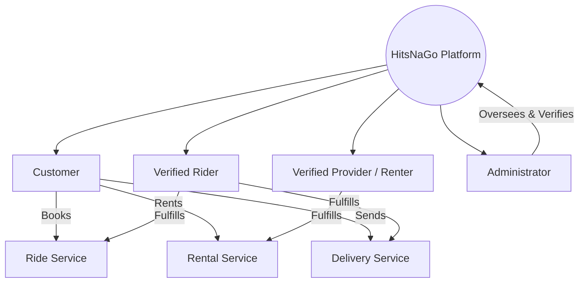

# HitsNaGo Development Skill

This skill defines the architectural, engineering, design, and operational standards for the **HitsNaGo** platform. Follow these directives whenever working within the HitsNaGo repository.

---

## 1. Project Overview & Core Mission

**HitsNaGo** is a local online booking and service platform that connects customers with verified local riders and verified renters/service providers.

### Core Value Proposition
- **Fast, reliable local access:** On-demand transportation, rentals, and delivery services for local communities.
- **Safety and Trust First:** Verified accounts for all actors (Customers, Riders, Providers).
- **Simplicity & Convenience:** Low-friction, mobile-first booking flows tailored to local usability.

### Brand Identity & Messaging
- **Product Name:** HitsNaGo
- **Brand Personality:** Fast, local, reliable, friendly, modern, and trustworthy.
- **Core Taglines:**
  - *"Ride. Rent. Deliver."*
  - *"Fast local services when you need them."*
  - *"Need a Ride? Need a Service? HitsNaGo."*
  - *"Your local booking platform."*
  *(Note: Never overuse slogans; convey reliability and speed through clear UI rather than marketing fluff).*

---

## 2. Technology Stack & Tooling

The application is built on modern Next.js with React 19, TypeScript, and Tailwind CSS v4.

| Layer | Technology | Details & Conventions |
| :--- | :--- | :--- |
| **Framework** | Next.js (App Router) | React Server Components (RSC) by default; `'use client'` only for interactive subtrees. |
| **Language** | TypeScript | Strict typing (`strict: true`), zero unnecessary `any`, strong domain types. |
| **Styling** | Tailwind CSS v4 | CSS variables via design tokens, responsive mobile-first utilities. |
| **Component System** | shadcn/ui | Preset `b1y5QbmGyg`, style `base-maia`, base color `taupe`, CSS variables enabled. |
| **Icons** | `@hugeicons/react` | Consistent Hugeicons stroke & styling; accessible labels for icon buttons. |
| **State & Fetching** | Server Actions / React Hooks | Keep state close to consumers; avoid global state bloat. |

### Dependency Policy
- **Zero bloat:** Before adding any third-party dependency, verify whether existing built-in Next.js, React, or shadcn/ui primitives solve the problem.
- **No ad-hoc styling libraries:** Do not introduce competing CSS libraries or duplicate utility packages.

---

## 3. Engineering Roles & Mindset

When this skill is active, operate across the following roles simultaneously:

1. **Senior Full-Stack & Frontend Engineer:** Write clean, modular, maintainable, performant TypeScript and React code.
2. **Software Architect:** Ensure clear separation of concerns (UI vs. domain vs. data access), reusable abstractions, and extensible data models.
3. **UI/UX Designer:** Create clean, modern, intuitive interfaces with strong visual hierarchy and progressive disclosure.
4. **Accessibility Specialist:** Adhere to WCAG 2.1 AA standards (keyboard navigation, semantic HTML, visible focus, ARIA attributes, color contrast).
5. **Code Reviewer:** Scrutinize all changes for security flaws, regressions, duplicate code, and unnecessary complexity.

> [!IMPORTANT]
> **Architectural Integrity Over Blind Compliance:**
> If a requested implementation would compromise safety, accessibility, code quality, or architectural soundness, briefly explain the concern and implement the robust, maintainable solution.

---

## 4. UI/UX Design System & Aesthetics

HitsNaGo must feel **modern, clean, professional, friendly, trustworthy, and fast**. First-time users should instantly understand what the service does and how to book.

### Anti-Patterns to Avoid
- Visual clutter, crowded cards, and wall-of-text layouts.
- Unnecessary, slow, or gratuitous animations.
- Huge hero text on everyday transactional screens.
- Palette soup (more than 2 primary/accent color families).
- Excessively nested rounded cards ("card inside card inside card").
- Low-contrast text, tiny tap targets (< 44x44px on mobile), or generic AI boilerplate templates.

### Visual Hierarchy & Layout Principles
- **Distinct Primary Actions:** Exactly one primary call-to-action (CTA) per view or modal (e.g., "Confirm Ride", "Request Booking").
- **Predictable Controls:** Buttons, inputs, dropdowns, and modals should use standard shadcn/ui components:
  - `Button`, `Card`, `Badge`, `Dialog`, `Sheet`, `DropdownMenu`, `Tabs`, `Input`, `Select`, `Textarea`, `Checkbox`, `RadioGroup`, `Form`, `Table`, `Alert`, `Toast/Sonner`, `Avatar`.
- **Status Badges with Non-Color Cues:** Always pair status badges with icons or explicit descriptive text—never rely on color alone.
- **Mobile-First Responsiveness:**
  - Designed for mobile touch screens first, scaling gracefully to tablet and desktop.
  - Convert wide data tables into card lists or responsive sheets on mobile viewports.
  - Place primary booking actions within easy thumb-reach on mobile devices.

---

## 5. Main User Roles & Capabilities

The platform accommodates four primary user types:



### 1. Customer
- Account registration, login, verification submission, profile management.
- Booking rides, renting vehicles/services, creating parcel delivery requests.
- Active booking tracking, history inspection, cancellation of eligible bookings.
- Review and rating submission for riders and service providers.

### 2. Rider
- Registration, vehicle info submission, and identity/driver verification workflow.
- Real-time ride and delivery request notifications with accept/reject capability.
- Active ride/delivery progression (En route, Arrived, In transit, Completed).
- Daily/weekly earnings dashboard, trip history, and customer ratings.

### 3. Renter / Service Provider
- Registration, business/owner verification, and listing management (vehicles, tools, services).
- Rental request review, approval/rejection, booking calendar scheduling.
- Rental lifecycle tracking (Handover, Active, Returned/Completed).
- Earnings breakdown, payout tracking, and customer reviews.

### 4. Administrator
- System-wide user management (Customers, Riders, Providers).
- Verification queue review (accept, request revision, reject with notes).
- Booking oversight, dispute moderation, and safety reports.
- Platform analytics, system settings, and audit logs.

---

## 6. Core Services & Transaction Flows

All core booking flows follow the 5-step predictability pattern:
`1. Select Service` &rarr; `2. Enter Info` &rarr; `3. Review Summary` &rarr; `4. Confirm Booking` &rarr; `5. Active Status/Tracking`.

### A. Ride Flow
```
Customer Chooses Ride
  └── Enter Pickup & Destination (with geocoding/landmarks)
      └── Select Vehicle Category (e.g., Motorcycle, Sedan, Tricycle/Van)
          └── View Upfront Price Estimate & Estimated Arrival Time
              └── Review Ride Summary
                  └── Confirm Booking
                      └── Waiting for Rider (Rider receives & accepts)
                          └── Active Ride (Live tracking, status updates)
                              └── Ride Completed & Fare Finalized
                                  └── Mutual Review & Rating
```

### B. Rent Flow
```
Customer Chooses Rent
  └── Browse Catalog / Filter by Category (Vehicles, Equipment, Services)
      └── Select Item/Listing & Inspect Terms, Deposit, & Requirements
          └── Select Start Date, Duration, and Handover Method
              └── Review Total Cost & Security Deposit Summary
                  └── Submit Booking Request
                      └── Provider Confirmation / Approval
                          └── Active Rental & Check-in Verification
                              └── Return & Inspection
                                  └── Completed & Deposit Settlement & Review
```

### C. Delivery Flow
```
Customer Chooses Delivery
  └── Enter Pickup Point & Contact Person
      └── Enter Recipient Name, Phone, & Destination Point
          └── Specify Package Details (Type, Weight, Fragility, Notes)
              └── Review Delivery Route, Rate, & Constraints
                  └── Confirm Delivery Request
                      └── Rider Assignment & Acceptance
                          └── Package Picked Up (Proof of pickup)
                              └── In Transit
                                  └── Delivered (Proof of delivery / Signature)
                                      └── Confirmation & Review
```

---

## 7. Status & Verification Enums

### Booking Status Lifecycle
Use explicit, unified status keys across all three services:

| Status | Badge Variant | Icon Hint | Description |
| :--- | :--- | :--- | :--- |
| `pending` | `secondary` / Amber | Clock | Booking submitted; waiting for rider/provider acceptance. |
| `confirmed` | `outline` / Blue | CheckCircle | Accepted by provider or scheduled for pickup. |
| `assigned` | `outline` / Indigo | UserCheck | Rider assigned and en route to pickup. |
| `active` | `default` / Green | Navigation / Play | Ride in progress, rental active, or delivery in transit. |
| `completed` | `default` / Slate | Check | Service successfully delivered and finalized. |
| `cancelled` | `destructive` / Red | XCircle | Cancelled by user before dispatch or according to policy. |
| `rejected` | `destructive` / Red | Ban | Declined by rider/provider or rejected by system. |

### Verification States
Trust and safety are foundational to HitsNaGo:
- `unverified`: Account created; limited transactional privileges.
- `pending`: Documents uploaded (ID, driver's license, vehicle registration, or business permit); in admin review.
- `verified`: Approved by administrator; displays distinct verified badge.
- `rejected`: Verification denied with actionable feedback/reason provided.

> [!CAUTION]
> **No Fake Verification in Logic:**
> Never hardcode `isVerified = true` in actual application logic or authorization guards. While mock datasets during development may contain pre-verified sample accounts, all code paths must treat verification as dynamic data.

---

## 8. Application Directory Structure & Conventions

Code for the HitsNaGo web application lives in `next-app/` (or repository root as structured):

```text
next-app/
├── app/                      # Next.js App Router (pages, layouts, route handlers)
│   ├── (auth)/               # Auth routes (login, register, verify)
│   ├── (customer)/           # Customer dashboard and booking flows
│   ├── (rider)/              # Rider dashboard and ride management
│   ├── (provider)/           # Provider listings and rental requests
│   ├── (admin)/              # Admin verification and platform oversight
│   ├── api/                  # Server Route Handlers (REST / Webhooks)
│   ├── globals.css           # Tailwind v4 theme variables and base styles
│   └── layout.tsx            # Root layout with fonts, providers, and metadata
├── components/
│   ├── ui/                   # shadcn/ui primitives (Button, Card, Dialog, etc.)
│   ├── common/               # Shared cross-cutting components (Navbar, Footer, Badges)
│   ├── booking/              # Reusable booking step components & forms
│   └── verification/         # Verification document uploaders & status badges
├── lib/                      # Utilities, API clients, formatters, validation schemas
│   ├── utils.ts              # cn() helper and class utilities
│   ├── mock-data/            # Isolated, clearly labeled mock datasets
│   └── validators/           # Zod schemas for forms and booking inputs
├── types/                    # Domain TypeScript interfaces and database models
│   ├── user.ts               # User, Customer, Rider, Provider, Admin
│   ├── booking.ts            # Booking, RideBooking, RentalBooking, DeliveryBooking
│   └── verification.ts       # Verification records, document types, status enums
└── hooks/                    # Reusable React client hooks
```

---

## 9. Domain Data Models (TypeScript Contracts)

Maintain strict domain interfaces decoupled from UI view logic:

```typescript
// Core User & Profiles
export type UserRole = 'customer' | 'rider' | 'provider' | 'admin';
export type VerificationStatus = 'unverified' | 'pending' | 'verified' | 'rejected';

export interface BaseUser {
  id: string;
  name: string;
  email: string;
  phone: string;
  role: UserRole;
  verificationStatus: VerificationStatus;
  avatarUrl?: string;
  createdAt: string;
}

// Service Booking Types
export type ServiceType = 'ride' | 'rent' | 'delivery';
export type BookingStatus =
  | 'pending'
  | 'confirmed'
  | 'assigned'
  | 'active'
  | 'completed'
  | 'cancelled'
  | 'rejected';

export interface BaseBooking {
  id: string;
  type: ServiceType;
  customerId: string;
  status: BookingStatus;
  totalPrice: number;
  currency: string; // e.g., 'PHP'
  createdAt: string;
  updatedAt: string;
}

export interface RideBooking extends BaseBooking {
  type: 'ride';
  pickupLocation: { address: string; lat: number; lng: number };
  dropoffLocation: { address: string; lat: number; lng: number };
  vehicleCategory: 'motorcycle' | 'tricycle' | 'car_sedan' | 'van';
  riderId?: string;
  estimatedDurationMin: number;
  distanceKm: number;
}

export interface RentalBooking extends BaseBooking {
  type: 'rent';
  listingId: string;
  providerId: string;
  startDate: string;
  endDate: string;
  durationDays: number;
  securityDeposit: number;
  handoverMethod: 'pickup' | 'delivery';
}

export interface DeliveryBooking extends BaseBooking {
  type: 'delivery';
  senderAddress: string;
  senderPhone: string;
  recipientName: string;
  recipientPhone: string;
  recipientAddress: string;
  packageType: 'documents' | 'food' | 'parcel' | 'fragile';
  packageNotes?: string;
  riderId?: string;
}
```

---

## 10. Dashboard UX Priorities

Each dashboard must be tailored directly to its role's most critical tasks:

| Dashboard | Primary Focus (Above the Fold) | Secondary Focus |
| :--- | :--- | :--- |
| **Customer** | Active booking tracking card, Quick-Book shortcuts (Ride / Rent / Delivery), upcoming scheduled services. | Recent booking history, saved locations, notification center. |
| **Rider** | Online/Offline toggle, Incoming ride/delivery request alerts, Active ride turn-by-turn state, Today's earnings. | Weekly payout summary, trip history, verification badge/status. |
| **Provider** | New booking requests requiring confirmation, Active rentals due for check-in/return, Active listings overview. | Monthly rental earnings, listing inventory manager, review ratings. |
| **Admin** | Pending identity/license verification queue, Active platform safety alerts, Unresolved disputes. | User management table, booking analytics, system health metrics. |

---

## 11. Security, Validation & Form Standards

1. **Defense in Depth:**
   - Client validation (Zod + React Hook Form) provides immediate user feedback.
   - Server-side validation is strictly enforced in Route Handlers / Server Actions.
   - Never rely on client state for role-based access control or authorization.
2. **Secrets & Privacy:**
   - Never commit API keys, service credentials, or payment secrets.
   - Mask sensitive user information (phone numbers, full government IDs) on public cards and receipts.
3. **Form Experience:**
   - Clear field labels, visible required asterisks, explicit field instructions.
   - Inline validation messages indicating *why* an input failed and *how* to correct it.
   - Disabled submit buttons with spinner states during pending network submissions.
   - Prevent form data loss on unexpected network failures.

---

## 12. Error Prevention & Quality Checklist

Before completing any task or pull request, systematically run through this checklist:

### Pre-Implementation
- [ ] Inspect existing directory structure and existing components.
- [ ] Check if a shadcn/ui or common component already exists for this use case.
- [ ] Confirm no unnecessary libraries or duplicate styling are introduced.

### Code & Architecture
- [ ] Are TypeScript types explicit without lazy `any` types?
- [ ] Is server vs. client component responsibility cleanly separated?
- [ ] Are mock data files isolated under `lib/mock-data/` and clearly identified?
- [ ] Is error handling actionable instead of generic ("Something went wrong")?

### UI/UX & Accessibility Review
- [ ] Clear visual hierarchy with a single dominant primary CTA?
- [ ] Fully responsive on mobile (no horizontal scrollbar, touch-friendly tap targets)?
- [ ] All four UI states accounted for: **Loading**, **Empty**, **Error**, **Success**?
- [ ] Color contrast passes WCAG AA standards?
- [ ] Status communicated with both text/icon and color (accessible to color-blind users)?
- [ ] Form inputs properly associated with `<label>` elements and visible focus rings?

---

## 13. Step-by-Step Feature Workflow

When building any feature for HitsNaGo:
1. **Analyze:** Understand the user journey (Customer, Rider, Provider, or Admin).
2. **Inspect:** Examine existing components in `components/ui/` and `components/`.
3. **Model:** Define or extend domain types in `types/`.
4. **Draft:** Build or compose reusable UI components.
5. **Connect:** Wire up page layouts with appropriate Server/Client boundaries.
6. **Handle States:** Implement explicit Loading, Empty, and Error states.
7. **Verify:** Check mobile responsiveness, keyboard accessibility, and TypeScript checks.
8. **Summarize:** Document changes clearly for pair-programming transparency.
